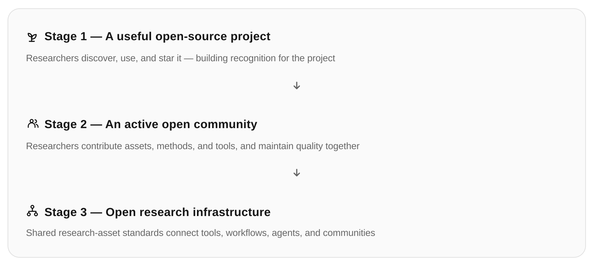

# Open Research Assets · Curated Research Gallery & Skills

**[简体中文](README.md) · English · [Website](https://openresearchassets.github.io/) · [For AI agents](https://openresearchassets.github.io/for-agents/)**

Research assets should be more than bookmarks. They should tell us **when to use them, what transfers, what to avoid, and where they came from**.

**Two core collections:** [beautiful, reusable scientific figures](https://openresearchassets.github.io/#gallery) and [select Skills / Workflows](https://openresearchassets.github.io/#skills), curated either by verifiable public GitHub popularity or evidenced firsthand project practice. Stars are not quality evidence; legacy paper analyses are supporting references, not the main product.

**Open contributions:** Any GitHub user can [submit a research asset](https://openresearchassets.github.io/contribute.html) without repository write access. Assets are curated before publication; verified contributors and acceptance dates are recorded separately from original creators. [Community and feedback setup](docs/COMMUNITY.md).

**Community vs. curated:** Pending submissions receive GitHub Issue reactions and comments without editorial approval; accepted asset detail pages use giscus / GitHub Discussions for independent reactions and comments. These counts are not automatically combined.

## Website information architecture

The three primary content destinations are **[Curated](index.html)**, **[Community](community.html)** and **[Findings](findings.html)**. **[Contribute](contribute.html)** remains a separate submission action, not a fourth content collection. Within Curated, the two content types are **Research Gallery** (including editable SVG studies) and **Skills / Workflows**. Quality tools, principles, AI-readable resources and licensing are secondary links in a shared footer.

The primary navigation/footer are authored once in `js/navigation.js` rather than duplicated across pages. Existing external artwork, citations and editorial data remain unchanged.

**Findings** automatically captures Hugging Face trending papers, GitHub Trending repositories, Skills and recent workflow projects into a source-attributed [snapshot](data/findings.json), refreshed by [GitHub Actions](.github/workflows/findings.yml). The Findings page now supports **on-site progressive reading of up to 100 HF abstracts and source-extracted GitHub README descriptions**. Google Cloud Translation is an optional server-only, budgeted, cached integration; original texts remain available, and no browser token is exposed. Signals are source-specific and never represented as editorial endorsement; [methodology and translation setup](docs/FINDINGS.md).

## Community and Curated are two different collection tiers

- **[Community](community.html)** automatically displays open GitHub Issue Form submissions, attribution, dates, real 👍 reactions and discussion counts. Contributors do not wait for editorial approval before appearing. Search, type filtering, newest/likes/comments sorting are available. Unreviewed external media is never mirrored.
- **[Curated](index.html#gallery)** maintains editorial standards for research visuals and Skills / Workflows using the canonical `catalog/index.json`. The curated detail page has a separate giscus discussion.

These are collection tiers, whereas Gallery / Skills are asset types. Issue reactions and giscus reactions remain separate. [Community rules](docs/COMMUNITY.md).

## Two core collections

| Collection | What you get | Selection standard |
|---|---|---|
| **[Research Gallery](https://openresearchassets.github.io/#gallery)** | Exceptional figure references, project websites, and [editable SVGs](https://openresearchassets.github.io/#assets) | Visual excellence, scientific clarity, original provenance and actual transferability |
| **[Research Skills / Workflows](https://openresearchassets.github.io/#skills)** | Curated skills, tools and workflows for actual research tasks | **Popular**: dated GitHub repository stars, clearly not personally tested; **Practice**: specific public project artifacts showing usage |

Popularity is not validated usefulness. A protocol without usage evidence is a candidate, never labeled “field-tested.” Original paper reviews and pedagogical examples remain available under [examples/](examples/README.md) as secondary reference, not the main product.

[Agent catalog](for-agents/) · [Contribute](CONTRIBUTING.md) · [Report an issue](https://github.com/OpenResearchAssets/openresearchassets.github.io/issues/new/choose)

## Four genuinely different visual design types (October 2026)

Seven retained visual references (GridAR excluded for failing visual curation): **Teasers** ([InstructPix2Pix](https://openresearchassets.github.io/asset.html?id=instruct-pix2pix-teaser)); **qualitative results** ([UltraEdit](https://openresearchassets.github.io/asset.html?id=ultraedit-qualitative), [Fast Learning Radiance Fields](https://openresearchassets.github.io/asset.html?id=fastnerf-zoom-results)); **real ablations** ([Specialist Diffusion](https://openresearchassets.github.io/asset.html?id=specialist-diffusion-ablation), [EgoEngine](https://openresearchassets.github.io/asset.html?id=egoengine-ablation)); and **interactive project sites** ([Nerfies — official site](https://nerfies.github.io/), [HyperNeRF — official site](https://hypernerf.github.io/)). The two website thumbnails are explicitly *individual source media*, not captured homepage screenshots. No original art is rehosted.

## New authored-source Gallery picks (2026-10-25)

Five additional author-hosted visual references: [VGGT architecture](https://openresearchassets.github.io/asset.html?id=vggt-architecture), [DreamDojo method overview](https://openresearchassets.github.io/asset.html?id=dreamdojo-overview), [VideoMimic real-to-sim pipeline](https://openresearchassets.github.io/asset.html?id=videomimic-real2sim), [VideoMimic approach overview](https://openresearchassets.github.io/asset.html?id=videomimic-approach), and [WonderZoom teaser](https://openresearchassets.github.io/asset.html?id=wonderzoom-teaser). Each record explains visual composition, reusable design patterns, identity and limits. **Externally linked author artwork only; no redistribution or editable-source claim.** Ordinary dense technical diagrams not meeting the design-first bar were excluded.

## Mission and intended use

**Our long-term goal is to make research experience directly usable by AI agents.** Given a task and one OpenResearchAssets URL, a web-capable agent should be able to discover relevant, trustworthy research lessons, tools, editable assets, and actionable workflows across the research lifecycle—from ideation and literature review to methods, experiments, evaluation, writing, websites, and release—without repeated manual searches or elaborate instructions. Using the assets in a real project still requires appropriate file and tool permissions.

We are **not merely a gallery of attractive paper figures or a directory of links**. Each curated asset should state when to use it, what can be learned or reused, how to apply it, its scientific and licensing constraints, provenance, and how to verify the result. The goal is to reduce repeated searching, prompting, trial-and-error, human corrections, elapsed time, and unnecessary tokens. Success must be measured on real tasks by relevance, outcome quality, intervention count, time, and token usage—not by collection size alone.

The initial focus is AI, computer vision, robotics and research communication. Full-lifecycle support is an ambition, **not a claim that an autonomous research service is already deployed**.

## Open community trajectory (long-term vision)

OpenResearchAssets is an **independent open-source project**, not a personal portfolio. Its intended progression is: **(1)** a useful project that researchers discover and reuse; **(2)** a healthy community where independent researchers contribute and review assets, methods, and tools; **(3)** open research infrastructure with interoperable asset conventions, workflows, tools, and AI agents.

These are **aspirational stages, not shipped features or promised milestones**. We value verified reuse, scientific fidelity, source attribution, contributor retention, and transparent review more than stars alone. [Star the repository](https://github.com/OpenResearchAssets/openresearchassets.github.io), [contribute](CONTRIBUTING.md), or [propose an asset](https://github.com/OpenResearchAssets/openresearchassets.github.io/issues/new/choose). The [project strategy](docs/PRODUCT_STRATEGY.md) is the authoritative statement of current and future scope.

This Chinese-first, English-supported library spans research design, evaluation, writing and communication. The current public implementation includes:

- **73 structured entries** in [catalog/index.json](catalog/index.json), including separate teaser and project-site references for RoboRender, RoboDojo and SuperMimic.
- Browser-side search and facets for stages, domains and asset kinds, with per-asset usage and provenance pages.
- [Agent instructions](for-agents/) and [llms.txt](llms.txt) pointing to an openly readable machine catalog. These files do **not** mean there is an autonomous remote agent service.
- Four original Markdown research workflows covering literature, experiments, paper narratives and research release.
- Five original, editable SVG concept designs; an author-guided manual [quality checklist](quality.html); and an unvalidated [Quality Critic Skill](skills/quality-critic/SKILL.md).

Search the [interactive asset directory](https://openresearchassets.github.io/#references), or hand its URL to an agent that has web or file-reading capability. The JSON requires HTTP hosting; run \`python3 -m http.server 8000\` locally rather than opening the page with \`file://\`.

**Copyright:** Third-party paper figures, videos and website screenshots are not bundled or relicensed; visual previews without explicit authorization are locally authored structural diagrams, clearly labeled. The diagrammatic previews are **not** source figures. Our original SVG templates are CC BY 4.0; the code and Skill are MIT. See [asset policy](docs/ASSET_POLICY.md), [schema](docs/ASSET_SCHEMA.md), [contribution guide](CONTRIBUTING.md) and [AI maintenance rules](AGENTS.md).

**Current limitations:** no vector semantic search, no automated image review model, no remote autonomous research execution service, and no validated paid products. We do not present future features as shipped.

## Low-token AI catalog access

Agents should first read [the compact manifest](catalog/manifest.json), select a few relevant assets by task, stage and domain, then open only the corresponding [per-entry JSON files](catalog/entries/supermimic-teaser.json). The full [canonical catalog](catalog/index.json) remains the only authored data. Edit it, run `python3 tools/sync_catalog.py`, then `python3 tools/sync_catalog.py --check` before publishing. This is not a remotely executing AI service.

## Authentic, specifically verified source images

The three featured papers are represented by their **actual Figure 1** and the corresponding project-site references use actual homepage viewport screenshots. All six media files live in [the third-party ledger](assets/third-party/manifest.json), with precise origin, credit, capture date and transformations. The RoboRender paper figure carries CC BY 4.0 attribution; other previews retain source-owner rights and a correction/removal channel.

## Real-reference previews

Depth Anything 3 and third-party galleries link to original source images. All six featured RoboRender/RoboDojo/SuperMimic paper/site references instead have individually verified local previews. The discontinued RoboRender model-architecture record is not part of the current catalog.

### Verified paper figures versus genuine first-view website captures

The six featured RoboRender/RoboDojo/SuperMimic references now use their actual paper Figure 1 images and actual screenshots of each project's first website viewport, respectively. We do not substitute training-data charts for teasers, GPU decorations for scientific paper figures, or broken author-portfolio links for website captures. Each image records the source, original credit, processing and removal request channel; authored editorial SVG analyses remain optional detail-page aids.

## Thematic discovery

The curated catalog provides orthogonal filters for research domains, task topics, research stages, and asset types. Skills / Workflows add dedicated filters for tools, individual Skills, and executable workflows, while preserving distinct **popular external projects** and **evidenced project practice** tracks. Individual `SKILL.md` files are linked directly; GitHub stars on those cards refer to the **parent repository**, not to an individual skill. As of October 26, 2026, the catalog includes **73 structured records**, including **36 popularity-track picks** and **2 evidence-backed project workflows**. Inclusion does not imply our own performance evaluation.

### Source-reviewed individual Skills

13 additional individual upstream `SKILL.md` files now have concise, bilingual instructions for inputs, outputs, requirements, steps and checks, with a dated upstream file SHA. Browse each asset for a direct link to the original Skill. They have **not been executed or independently validated here**. The full 71-record catalog contains 36 popularity-track resources and four evidence-backed project workflows. See the [source audit](docs/SKILL_INTAKE_AUDIT.md) and [intake workflow](workflows/skill-source-intake.md).

### Reproducible public Skill-guided trials

Two [actual research asset analysis tasks](experiments/skill-trials/README.md) now run in GitHub Actions on the canonical 73-record catalog. The real pinned OpenAI notebook scaffold runs, notebook cells execute in a fresh kernel, and the visual analysis exports SVG/PNG/CSV. Ten objective checks passed in the newest run, including a source-audited figure from author-reported RoboRender task results. These results measure scripted correctness and runtime, **not** native automatic Skill invocation, model tokens, or causally attributable performance gains.
