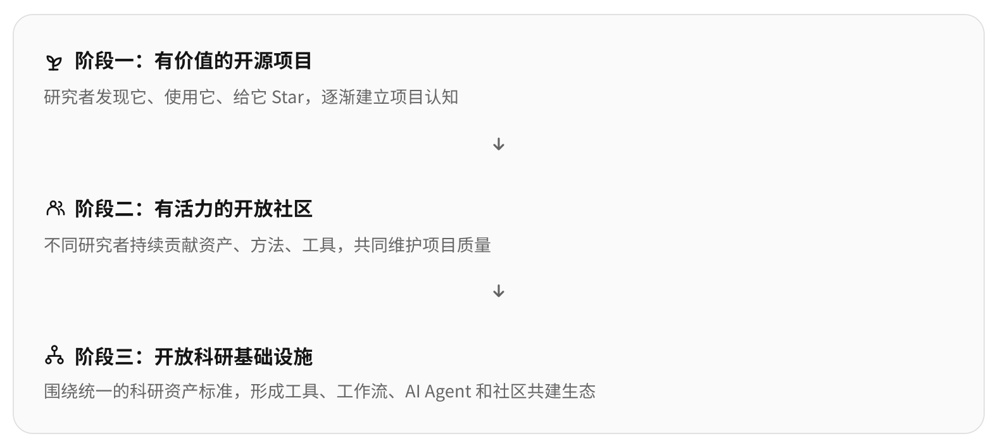

# Open Research Assets · 精选科研视觉与实用 Skills / Workflows

**中文（默认）** · [English](README.en.md) · [在线网站](https://openresearchassets.github.io/) · [给 AI 使用](https://openresearchassets.github.io/for-agents/)

**目前最重要的只有两件事：** [高审美科研配图与可编辑素材](https://openresearchassets.github.io/#gallery)，以及 [高热度 / 实践积累 Skills 与 Workflows](https://openresearchassets.github.io/#skills)。既有论文解释性页面仅用于必要的来源和设计佐证，不再作为网站的主要产品。外部 Star 是热度，不是使用验证；团队实践记录必须有公开成果证据。

> **科研资产不只是收藏，而是可以被发现、理解与复用的经验。**  
> 科学真实性先于外观；高质量的资产需要说明其用途、来源和使用边界。

OpenResearchAssets 面向科研生命周期，整理值得学习的论文视觉案例、优秀项目主页、可编辑原创素材、研究工具与可用的工作流。**中文为主、英文为辅**；允许人类按任务搜索，也提供无需付费 API 的结构化 AI 读取入口。

## 两个核心入口

| 产品支柱 | 你能直接得到什么 | 选品标准 |
|---|---|---|
| **[Research Gallery · 精选配图](https://openresearchassets.github.io/#gallery)** | 高审美科研 Teaser、Method、Results、优秀项目主页、[可编辑 SVG](https://openresearchassets.github.io/#assets) | 先看真实视觉质量、科学表达、可迁移构图和原始出处，宁缺毋滥 |
| **[Research Skills / Workflows](https://openresearchassets.github.io/#skills)** | 有用途和限制说明的精选 Agent Skills、工具与可复用研究流程 | **高热度**：核验 GitHub 仓库 Star、注明快照日期；**实践积累**：必须链接公开产物及实际使用证据 |

**Star 与实际效果是两回事。** 高热度项是外部精选，不表示本项目亲自运行；项目实践项有公开成果但未必经过独立效用评测。没有实践证据的普通 Markdown 清单和 Quality Critic 候选 Skill 不冒充“亲测”。

[为 Agent 提供结构化目录](for-agents/) · [任何人均可投稿科研资产](https://openresearchassets.github.io/contribute.html) · [投稿与互动说明](docs/COMMUNITY.md) · [提出问题 / 纠错](https://github.com/OpenResearchAssets/openresearchassets.github.io/issues/new/choose)

**附属材料**：历史论文分析与教学案例仍保留在 [examples/](examples/README.md) 供查阅、链接兼容和来源核验，不是网站的核心产品或内容增长方向。

## 四类视觉精选（2026-10-25）

这批刻意补齐过去偏弱的类型，不再继续堆积常规 Method 结构图：

| 类型 | 精选作品 | 值得迁移的视觉设计 |
|---|---|---|
| **Teaser** | [InstructPix2Pix](https://openresearchassets.github.io/asset.html?id=instruct-pix2pix-teaser) | 输入—指令—结果之间的直观视觉叙事 |
| **定性结果** | [UltraEdit](https://openresearchassets.github.io/asset.html?id=ultraedit-qualitative) · [Fast Learning Radiance Fields](https://openresearchassets.github.io/asset.html?id=fastnerf-zoom-results) | 对齐的多方法结果矩阵；彩色同位放大框 |
| **真正的消融** | [Specialist Diffusion](https://openresearchassets.github.io/asset.html?id=specialist-diffusion-ablation) · [EgoEngine](https://openresearchassets.github.io/asset.html?id=egoengine-ablation) | 保持输入条件不变，对照移除组件的结果与量化效果 |
| **交互式主页** | [Nerfies · 原作者主页](https://nerfies.github.io/) · [HyperNeRF · 原作者主页](https://hypernerf.github.io/) | 视频优先、交互参数与输出同步展示；预览只是官网功能素材，**不是网站首屏截图** |

所有入选原图仍从**作者实际网站或仓库提供外链**，我们只进行原创的构图与复用分析。结果、消融和网站交互不能由静态缩略图替代科学验收。本批最终精选 7 条（GridAR 已因视觉质量不达标移除）。Gallery 目前为 28 条视觉资产，完整目录 39 条记录。

## 本轮新增高审美视觉精选（2026-10-25）

新增五条经过原作者**网站内容与公开仓库文件路径**双重核对的图稿参考；不把普通论文解读当作资产，也不将第三方图片复制进本站仓库。

| 原始作品 | 侧重的视觉设计 | 资产档案 |
|---|---|---|
| VGGT · Architecture | 统一骨干与多任务输出的分层 | [查看](https://openresearchassets.github.io/asset.html?id=vggt-architecture) |
| DreamDojo · Method Overview | 真人视频、两阶段训练与机器人视觉结合 | [查看](https://openresearchassets.github.io/asset.html?id=dreamdojo-overview) |
| VideoMimic · Real-to-Sim | 多阶段真实视觉与几何动作转换 | [查看](https://openresearchassets.github.io/asset.html?id=videomimic-real2sim) |
| VideoMimic · Approach | 技术模块总览与过程图的分工 | [查看](https://openresearchassets.github.io/asset.html?id=videomimic-approach) |
| WonderZoom · Teaser | 连续放大、空间尺度与 3D 视觉叙事 | [查看](https://openresearchassets.github.io/asset.html?id=wonderzoom-teaser) |

所有图片均为 **外链原作者文件**，不意味着我们拥有再分发或改编许可。真实原图加载失败时保留原始网站/文件链接。此次另外评估过 VisualMimic Method 图，但它更偏常规技术排布，未进入高审美精选；宁缺毋滥。

## 项目目标与用途

**长期目标：让科研经验真正成为 AI 可使用的生产力。** 我们希望未来的研究者在选题、调研、方法设计、实验、评估、写作、投稿、项目主页和成果传播等任务中，只需给有网页读取能力的 AI **一个 OpenResearchAssets 网址**，AI 就能根据当前任务主动检索并理解相关资产，选择可复用的方法、实践经验、工具、Skill、可编辑素材及工作流程，在获得必要项目文件和工具权限后将其应用于实际工作，而不必反复让人类编写详细提示词或从零检索同类资料。

这不是一个单纯收藏优秀论文图、项目主页的 Gallery，也不是只有外部链接的 Awesome List。**每项资产要回答：什么时候用、为什么有价值、怎么使用或迁移、有哪些风险与约束、出处和授权是什么、最终如何验收。** 好看的 Teaser、复现经验、实验排错方法、论文叙事技巧和 Agent 工作流，只有能够帮助下一次实际科研任务，才构成我们的核心价值。

**希望减少的成本**是重复搜索、重复解释、工具试错、人工返工以及无关内容带来的时间与 Token 开销。我们将用真实任务比较资产检索正确性、最终工作质量、人工干预次数、完成耗时和 Token 成本，而不是只用收录数量或页面访问量衡量成败。

**近期建设**从 AI / CV / Robotics 领域和科研视觉表达起步，优先保证资产质量、可追溯性与可复用性，再稳步扩展科研全流程；**长期愿景不等于已上线能力**：目前提供静态检索、结构化 AI 入口和部分工具/工作流，尚不能仅凭一个网址替 AI 获得项目文件权限或自动完成整个科研流程。

## 开放社区的长期方向（愿景）

OpenResearchAssets 由独立 GitHub Organization 维护，目标是建设**项目本身被记住、研究者可以共同建设**的公共科研资源，而非任何人的个人作品集。我们将按价值和社区实际成熟度逐步发展：

[English SVG](assets/diagrams/community-trajectory.en.svg)

1. **有价值的开源项目：** 用户真正发现、使用、复用资产，逐步建立独立项目认知。
2. **有活力的开放社区：** 外部研究者持续贡献可验证的科研资产、工作流和工具，共同维护质量。
3. **开放科研基础设施：** 在真实使用需求推动下，形成可复用的科研资产标准、工具和 AI Agent 生态。

这三个阶段是**长期愿景，不是已实现功能，也没有预设期限**。我们关心真实使用与复用质量、持续贡献和开放协作；Star 是项目关注度信号，而不是唯一成功指标。社区采用公开 Issue / PR 贡献和透明审核，科学真实性、可追溯性与授权边界优先。

**[在 GitHub Star 项目](https://github.com/OpenResearchAssets/openresearchassets.github.io)** · **[贡献科研资产](CONTRIBUTING.md)** · **[提出建议](https://github.com/OpenResearchAssets/openresearchassets.github.io/issues/new/choose)** · **[完整定位](docs/PRODUCT_STRATEGY.md)**

## 现在已经能用

| 内容 | 实际交付 | 边界 |
|---|---|---|
| [任务搜索与多维筛选](https://openresearchassets.github.io/#references) | 双语关键词、科研阶段、领域、资产类型过滤；独立详情页 | 当前是浏览器本地筛选，不是语义向量检索 |
| [结构化资产目录](catalog/index.json) · [轻量 AI 索引](catalog/manifest.json) | 以 `catalog/index.json` 为唯一事实源，当前 39 条资产记录，其中 Gallery 有 28 条视觉资产；新收录的 7 条 Teaser/结果/消融/科研主页参考提供原作者直达入口 | 既有六张案例封面均已核实对应论文 Figure 1 或官方主页首屏（RoboRender 论文图为 CC BY 4.0；其余按具体来源与评论预览说明处理） |
| [AI 使用指南](for-agents/) · [llms.txt](llms.txt) | 无需认证的 JSON、Markdown 导航和来源链接 | AI 的具体执行能力取决于 Agent 文件与工具权限 |
| [原创可编辑 SVG](assets/templates/) | 5 份概念模板：Teaser、流程、结果、主页故事板、论点—证据映射 | 只展示结构和占位，不代表真实实验 |
| [人工质量自查](quality.html) | 五类审核对象、问题手工勾选和 Markdown 报告 | **不自动读取或诊断图片** |
| [质量审核 Skill](skills/quality-critic/SKILL.md) | 可供有文件读取能力的 AI 参考的审核流程 | 未经过独立专家效果验证 |

## 使用

**人类：** 在[资产目录](https://openresearchassets.github.io/#references)输入任务关键词，筛选科研阶段、领域、类型。打开独立详情查看何时适用、可学什么、注意事项和原始链接。

**AI：** 把[网站地址](https://openresearchassets.github.io/)交给有浏览/文件工具的 Agent；使用 [for-agents/README.md](for-agents/README.md) 和 [catalog/manifest.json](catalog/manifest.json) 先定位任务，再按单项 `entry` 路径获取完整资产说明。AI 不能仅凭网页就获得本地文件执行权。

本地浏览请开启静态服务器（JSON 使用 \`fetch\`，直接打开 \`file://\` 的首页可能无法加载目录）：

\`\`\`bash
python3 -m http.server 8000
python3 tools/sync_catalog.py --check
python3 tests/check_project.py
# 可选：安装 Playwright 与 Chromium 后运行
python3 tests/browser_offline_smoke.py
\`\`\`

## 版权异议与素材撤除

第三方作品归原权利人。我们为科研检索、引用导航及具体设计分析整理公开来源，网站代码、原创 SVG 与第三方图片不共享同一许可证。**如您是权利人且对某项收录或展示有异议，请[提交素材撤除或更正申请](https://github.com/OpenResearchAssets/openresearchassets.github.io/issues/new?template=asset-removal.yml)**，注明站内资产 URL 与原始来源。我们会及时核实并处理。公开 Issue 中请勿提交私人证件或敏感资料；必要时可使用 [GitHub 版权投诉入口](https://github.com/contact/dmca)。

详细步骤和边界见 [资产来源与许可规范](docs/ASSET_POLICY.md)。署名、非盈利与可撤除机制不能替代必要的使用许可。

## 资产与维护原则

1. **单一数据源：** \`catalog/index.json\` 是人类网站与 Agent 共享的唯一资产目录；[资产模型](docs/ASSET_SCHEMA.md) 明确字段。
2. **真实与可溯源：** 外部资产标注原始来源；分析不能冒充论文结论，且不重发无明确权限的第三方原图。
3. **允许不同类型资源：** 独立的设计案例、可编辑文件、工具和科研经验应按使用任务组织，而不是被统一塞进视觉图库。
4. **小而精、可实际使用：** 条目讲清 \`use_when → learn → avoid\`，保持当前数据可靠性，不靠条目数量竞争。
5. **只宣传实现功能：** 公开站未提供自动 AI 质量模型、远程科研 Agent 执行器或商业服务。
6. **中英同步与真实页面验收：** 中文权威，英文完整；新增功能需要检查移动端/桌面端和真实入口。
7. **两仓库隔离：** 本仓库只放获准公开内容；私有研究、商业假设和未发表实验仅在独立私有工作区处理，不从这里自动读取或链接。

第三方内容与改造的进一步约束见 [资产政策](docs/ASSET_POLICY.md)；贡献方式见 [CONTRIBUTING.md](CONTRIBUTING.md)，AI 维护流程见 [AGENTS.md](AGENTS.md)。

## 文件导航

| 位置 | 内容 |
|---|---|
| \`catalog/index.json\` | 所有资产唯一数据源：中英说明、标签、复用建议及原始链接 |
| \`index.html\` / \`asset.html\` | 任务检索与独立资产详情 |
| \`js/catalog.js\` / \`css/catalog.css\` | 资产 UI、原创建模缩略图与筛选逻辑 |
| \`for-agents/\` / \`llms.txt\` | 面向 AI 的公开自助使用入口 |
| \`assets/templates/\`、\`assets/previews/\` | 本站原创可编辑 SVG 与预览 |
| \`skills/quality-critic/\` | 可供 Agent 参考的质量审核协议 |
| \`docs/\`、\`tests/\` | 资产政策、质量标准、工程验收 |

**License**：程序和 Skill 为 MIT；原创 SVG/预览为 CC BY 4.0；第三方引用内容的版权不随链接归本仓库。详见 [LICENSE](LICENSE) 和 [资产政策](docs/ASSET_POLICY.md)。

## 真实第三方视觉资产

**官方真实图优先展示**：首页首个视觉案例更新为 Depth Anything 3 的真实官网概览图，并保留 RoboRender 的真实项目配图；精选方向已改为多视角视觉结果与信息表达；原 RoboRender 模型结构图已从当前目录撤除。自动化验收检查首页首卡指向 Depth Anything 3 官方图；第三方外链媒体是否可用需另行联网核验。

本站现在将 RoboRender / RoboDojo / SuperMimic 的论文 Figure 1 与三个官网首屏截图一一对应，六张核实图片保存在 `assets/third-party/`。每项精确标明是论文图还是主页截图、原始来源、署名和缩略处理，具体使用条件与版权异议处理见 [第三方资产台账](assets/third-party/manifest.json) 和 [资产政策](docs/ASSET_POLICY.md)。

### 六个精品案例：图像身份逐一核对

RoboRender、RoboDojo、SuperMimic 的论文类条目现在展示真正的 Figure 1（或官方原版论文总览），主页类展示源网站浏览器首屏截图。**不再用训练数据图充当 Teaser，不用 GPU 墙图充当 SuperMimic Figure 1，也不用 404 的作者图片充当 RoboDojo 主页。** 图像带作者、原始论文/网页地址、裁切或压缩说明和异议撤除渠道；分析型 SVG 退居详情页的辅助材料。
