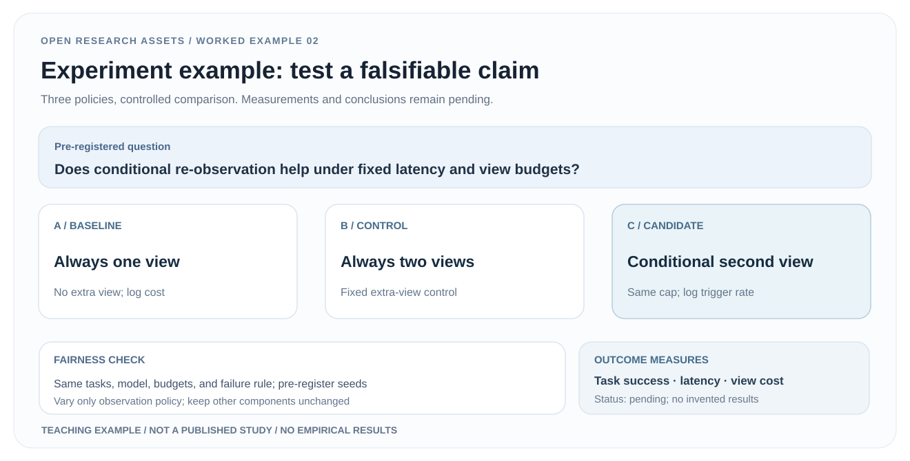

# 02 · From a scientific claim to a falsifiable experiment

> **Design-only protocol; not executed.** No robot trials, measured comparisons or outcome claims. All numeric result fields are intentionally blank.

[Download SVG](../assets/examples/experiment-design.en.svg) · [Fillable evidence CSV](evidence-register.csv) · [中文](experiment-design.zh.md) · [Examples page](../examples.html#experiment)

## 1. Input: a testable hypothesis

From the [shared brief](research-brief.md), a conditional extra viewpoint **might** improve the trade-off between task quality and acquisition costs. Actively search for counterexamples: extra latency with no gains, limited benefit on hard tasks, or dependence on a biased comparison.

## 2. Controlled variants

| Arm | Observation policy | Question |
|---|---|---|
| A · Single-view baseline | Always use the initial view only | What is the base cost and task result? |
| B · Fixed second view | Always request another available view | Is any gain merely due to more visual information? |
| C · Conditional second view | Additional view iff a **predefined** trigger fires | Does adaptive allocation deliver a better cost-quality trade-off? |

Use matched task partitions, models, initial conditions and declared budgets. Track *actual* extra observations, failed requests and time. Never weaken the baseline by silently reducing its resources. If a second view cannot be provided in some tasks, pre-register consistent treatment before evaluating B and C.

## 3. Protocol, before running anything

1. Freeze task scope, exclusions, repeats, unit of analysis, seeds and difficulty strata **before evaluation**.
2. Define success, partial success, failure, terminated and truncated consistently.
3. Capture request/delivery of each viewpoint, action count, robot operating time, end-to-end latency and explicit failure codes.
4. Choose task success as a candidate primary endpoint; track latency and observation counts as resource metrics. Select uncertainty quantification based on the true independent sampling unit.
5. Pre-register the trigger policy and where its hyperparameters are selected, with no test-set tuning.
6. Include negative trials, missing observations, trigger errors and expensive failures; separate exploratory analysis from preregistered hypotheses.

## 4. Concrete fillable artifact

[evidence-register.csv](evidence-register.csv) includes claim, comparison, split, policy version, seed, limits, measurement unit, raw evidence URL and status. **Keep result_value and uncertainty_or_ci blank until real evidence exists.** The A/B/C diagram represents a test design, not measured results.

Actual results require executed trials, traceable raw outputs, statistical verification and accurate reporting of hardware and run costs.

## 5. Acceptance and transfer

A falsification criterion is stated; policies are operationally reproducible; budgets and stopping rules are aligned; raw evidence supports every reported result; failures and costs appear alongside any gains; and logs allow the method figure's branches to be reconstructed.

**Provenance:** Original teaching protocol from [experiment-planning workflow](../workflows/experiment-planning.md) and [claim–evidence SVG](../assets/templates/claim-evidence-map.svg).
