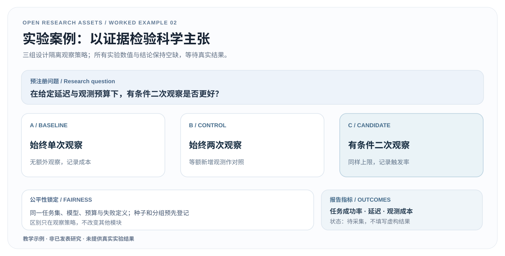

# 02 · 从科学主张到可证伪实验设计

> **教学协议，未执行。** 不包含机器人实验、基线运行、真实测量或性能结论。所有数值栏位故意留空。

[下载可编辑 SVG](../assets/examples/experiment-design.zh.svg) · [下载可填写 CSV](evidence-register.csv) · [English](experiment-design.en.md) · [案例页](../examples.html#experiment)

## 1. 输入：要检验而不是要宣传的主张

沿用 [共享简报](research-brief.md) 的假设：条件性增加一个视角，**可能**在任务结果与观察成本之间产生更好的折中。

要主动寻找反例：它可能增加延迟但不改善成功率，也可能仅在极少数困难任务上发挥作用；如果没有恰当基线，这些情况很容易被忽略。

## 2. 把机制拆成可比较的组

| 组别 | 策略 | 要回答的问题 |
|---|---|---|
| A · 单视角基线 | 固定仅初始观测 | 没有额外观察时的性能/成本 |
| B · 固定双视角 | 总是追加一次可用观察 | 改善是否仅来自增加信息量 |
| C · 条件性观察 | 仅在**预先确定**的触发规则命中时追加观察 | 自适应策略的成本—质量折中是否优于 A、B |

**关键公平性：** 同一任务池与划分、训练数据、模型版本、初始状态与评估预算；把各组实际使用的额外观察次数、观测失败与耗时透明报告。绝不能通过限制基线的模型或可用资源制造优势。B 组仅在物理可获取第二视角的任务中定义；不可获取时需事先统一处理规则。

## 3. 预先定义协议，避免后验挑选

1. 列出任务范围、测试集排除项、重复次数/统计单位、随机种子及任务难度分层；**在运行前固定**。
2. 明确成功条件、部分成功、任务失败、terminated 和 truncated 的定义；评估处理一致。
3. 记录观察请求、观察是否交付、操作时长、机器人动作次数、任务成功、总延迟与失败类型。
4. 主要终点可为任务成功率；关键资源指标为总延迟、视角请求数与观测成本。置信区间和比较方法根据真实采样单位与独立性设定。
5. 给 C 组预先定义触发规则及超参数选择流程，避免在测试集上调参。
6. **同时报告负面结果**：不成功案例、视角不可用、触发策略误判、延迟变大；事后探索与预注册实验明确区分。

## 4. 可填写的实际产物

打开 [evidence-register.csv](evidence-register.csv)。每一行关联主张、对照、数据分割、模型/策略版本、种子、预算、指标、统计单位、原始证据链接和状态。**result_value 与 uncertainty_or_ci 留空是正确状态**，不能根据预期填写示例改善百分比。

图中 A/B/C 是比较设计而非结果图。只有采集真实数据并审核统计单位后，才能生成实际结果图/表。最终需要检查 GPU/硬件配置与运行成本，保障可复现性。

## 5. 验收与迁移

- 可以指出什么观察将**推翻**“自适应二次观察更好”的假设。
- 每个组别的预算、停止条件、观察失败处理规则都已可执行。
- 每个重要结论能追溯到 raw evidence 和预设实验协议。
- 负面结果与运行成本被完整记录，没有从概念图中暗示真实提升。
- 对应 [方法图](method-figure.zh.md) 中的每条路径都能在日志中复原。

**来源：** 本项目原创教学设计，延伸 [实验规划工作流](../workflows/experiment-planning.md) 与 [论点—证据 SVG](../assets/templates/claim-evidence-map.svg)。
