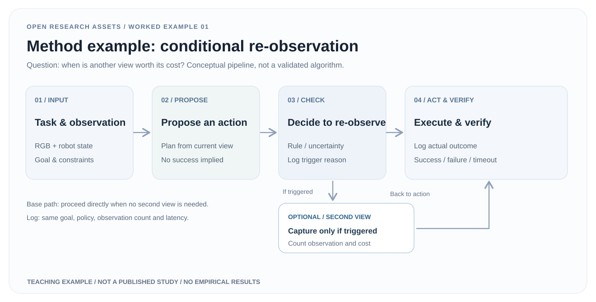

# 01 · From a research question to an editable method figure

> **Fully worked teaching example, invented scenario.** This is neither a published algorithm nor an executed robot study. See the [shared brief](research-brief.md).

[Download editable SVG](../assets/examples/method-figure.en.svg) · [中文](method-figure.zh.md) · [Examples page](../examples.html#method)

## 1. Research task and inputs

**Question:** Given an initial RGB observation, should a robot act immediately or request a second viewpoint under explicitly defined conditions?

Required real inputs for adaptation: task specification; camera frames and robot state semantics; action API; whether another view can be obtained; how its trigger is computed; and the success, failure, and timeout definitions. The figure itself contains no real sensor measurements or action trajectories.

## 2. Translate the method into a causal drawing

| Element | Show explicitly | Do not imply |
|---|---|---|
| Initial view | RGB, robot state and goal | An unspecified dataset |
| Candidate plan | A proposed action from current information | A correct plan |
| Re-observation gate | Predefined trigger before action | A proven confidence estimator |
| Additional viewpoint | Conditional capture and accounting for time/cost | A free extra observation |
| Act and verify | Real outcomes and failure logging | An achieved performance gain |

Branches belong at the actual decision point. If the trigger does not fire, proceed directly to action; arrows communicate information and control flow, not empirical superiority.

## 3. Editable deliverable and reuse procedure

1. Open the [native SVG](../assets/examples/method-figure.en.svg) in an SVG-capable editor.
2. Replace each task, input, decision, sensor and action label with its actual implementation. Remove any nonexistent mechanism.
3. Specify the trigger in methods text: estimation, threshold calibration, observation availability and fallback rules.
4. Inspect the arrows and branching logic after editing. Test legibility at the paper's final column width and preserve both the SVG source and rendered output.

## 4. Acceptance criteria

- Every block maps to a defined module, variable, API or method step.
- Every optional path has entry and exit conditions, with no undocumented loop.
- Additional observations and latency are included in subsequent measurements.
- All shapes and labels remain individually editable; no screenshots are presented as real deployments.
- Continue to the [evaluation protocol](experiment-design.en.md) before making outcome claims.

## 5. When this fails

A second view may be unavailable, too slow, geometrically inconsistent or only selected through future-label leakage. If any of these apply, fix the research mechanism rather than cosmetically polishing the figure.

**Provenance:** Original teaching case by OpenResearchAssets; related material: [editable method template](../assets/templates/method-flow.svg) and [paper evidence workflow](../workflows/paper-evidence-story.md).
