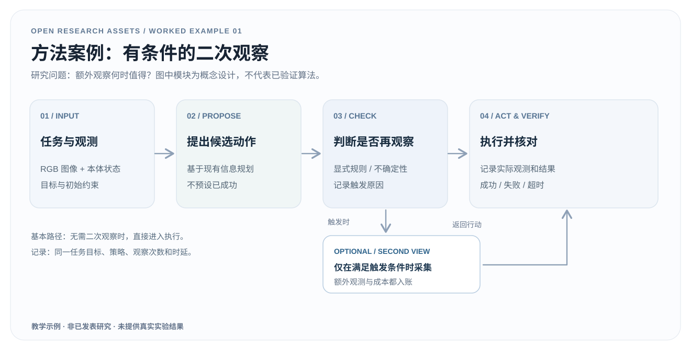

# 01 · 从问题到可编辑 Method Figure

> **完整教学案例，虚构研究情境。** 本案例不是已发表论文的方法，也没有系统部署或实验结果。共享研究问题见 [输入简报](research-brief.md)。

[下载可编辑 SVG](../assets/examples/method-figure.zh.svg) · [English](method-figure.en.md) · [返回案例页](../examples.html#method)

## 1. 任务与输入

**问题：** 机器人获取初始 RGB 观察后，是否应该立即执行动作，还是在部分情况下额外请求第二视角？

**需要的原始材料：** 任务目标、相机和机器人状态定义、动作接口、二次观察的物理可行性、触发策略的确定方式、成功/失败/超时判据。这里仅给出**待实现的机制结构**，没有真实相机图像或任何真实动作记录。

## 2. 从方法描述提取可画的因果关系

| 元素 | 明确表达 | 刻意不表达 |
|---|---|---|
| 初始输入 | RGB 与本体状态，目标与约束 | 未给出来源的数据集 |
| 候选规划 | 根据当前观测提出行动 | 规划已正确 |
| 再观察判定 | 在执行前依据预设触发规则分支 | “不确定性评分一定有效” |
| 二次视角 | 只有触发时才采集，计入时延与预算 | 免费或随时可获得新观测 |
| 执行与核验 | 执行后记录结果和失败原因 | 方法成功率提升 |

将分支画在决策点而不是最终结果之后；无额外观察时直接进入执行。箭头表示**信息/控制流**，不是效果证明。

## 3. 产物与编辑方法

- 打开 [原生 SVG](../assets/examples/method-figure.zh.svg)（Inkscape、Illustrator 或支持 SVG 的编辑器）。
- 将研究对象、输入模态、条件判断、工具和动作标签替换为自己研究的真实定义，必要时删除不存在的模块。
- 把“触发规则”写到方法文字中：阈值从哪里来、何时计算、不能观察时如何回退。否则图只是一个未经定义的算法草图。
- 修改文字后检查连线是否仍表示正确执行顺序，并在**最终论文实际宽度**检查中文/英文文字是否清晰；保存 SVG 和最终 PDF/PNG 渲染供审查。

## 4. 可核验的完成标准

1. 图中每个模块可映射到方法章节的具体操作、变量或工具接口。
2. 每条可选路径有明确进入与退出条件，不会形成未说明的无限循环。
3. “第二视角”的额外成本（时间、传感器、采样次数）能被实验记录。
4. SVG 无内嵌位图，文字可独立编辑；未把概念图包装成真实系统运行截图。
5. 下一步用 [实验设计案例](experiment-design.zh.md) 检验实际收益，**不能在 Method Figure 上先写效果数字**。

## 5. 失效条件

如果第二视角不可获得、观测延迟不可控、相机位姿变换不可信，或者触发条件需使用未来信息，就必须修订方法定义，而不是只美化图。图形可以帮助审阅机制，但不能替代实现与验证。

**来源：** 本项目原创教学示例；相关可复用资产为 [通用 Method SVG 模板](../assets/templates/method-flow.svg) 和 [论文叙事工作流](../workflows/paper-evidence-story.md)。
