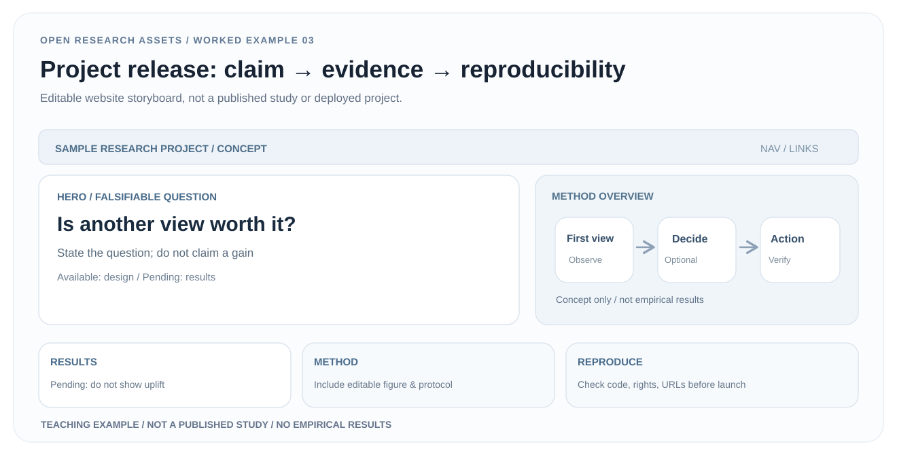

# 03 · From defensible evidence to a project homepage

> **This is an editable information-architecture storyboard, not a deployed research site.** There is no real paper, code, video, experiment or measured outcome.

[Download SVG](../assets/examples/project-homepage.en.svg) · [中文](project-homepage.zh.md) · [Examples page](../examples.html#release)

## 1. Input audit: what can legally and accurately be published?

Do not lead with a spectacular result and invent evidence later. Audit the preceding [research brief](research-brief.md) and [experiment register](evidence-register.csv).

| Item | Current teaching-case state | Requirement for real release |
|---|---|---|
| Scientific question | Clearly specified | Matches the actual paper |
| Method figure | Original **conceptual** SVG | Faithful to the final implementation |
| Quantitative comparison | **No measurements** | Raw traces, uncertainties and fair baselines |
| Robot demo or video | **Unavailable** | Real recording with publication rights |
| Paper, code, weights | **Not available** | Real working URLs, licensing and replication notes |

Never include fake functioning Paper / Code buttons, unmeasured percentage claims, fabricated demos or publication claims.

## 2. Evidence-first visual narrative

1. **Hero:** lead with the falsifiable question, “Is another view worth it?” rather than a performance assertion.
2. **Main figure:** only depict implemented or explicitly conceptual observation, decision and action relationships.
3. **Results:** show “pending” when there is no evidence; a placeholder is not a chart.
4. **Method:** point to the editable figure and frozen evaluation protocol.
5. **Reproduction and limitations:** distinguish available resources from unreleased materials, and list failure modes and dependencies.

The [editable storyboard SVG](../assets/examples/project-homepage.en.svg) can guide information design, but **it is not a working HTML page**. Real sites should be responsive, accessible text-based pages, not giant embedded images.

## 3. Publication workflow

- Replace every placeholder with validated scientific statements, actual figures, measured results and units.
- Map all quantitative claims to raw logs, transparent evaluation definitions and sufficient uncertainty reporting.
- If code is not available, say “not released” and avoid nonfunctional download controls.
- Audit permission to reproduce figures, logos, site captures and videos. Do not mislabel a concept illustration as a real figure.
- Test desktop/mobile layout, keyboard navigation, readable alt text, true working links and actual rendered page appearance.

## 4. Acceptance standard

A new reader should quickly understand the research question, available evidence, missing evidence, ability to reproduce and limitations. Promote the storyboard to a public research site only after its data, claims and assets truly exist.

**Provenance:** OpenResearchAssets original teaching case based on [research release workflow](../workflows/research-release.md) and the [homepage layout template](../assets/templates/project-homepage-layout.svg).
