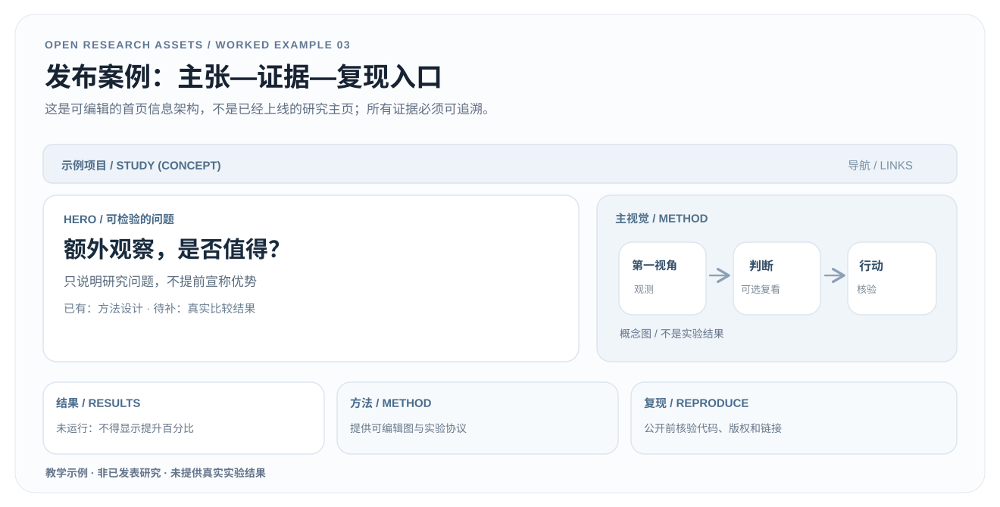

# 03 · 从真实研究证据到项目主页

> **这是公开教学用的网站信息架构，不是实际部署的机器人项目。** 页面故事板包含刻意留空的结果区，没有真实论文、代码、视频或实验数据。

[下载可编辑 SVG](../assets/examples/project-homepage.zh.svg) · [English](project-homepage.en.md) · [案例页](../examples.html#release)

## 1. 输入审计：哪些东西真的能发布？

项目首页不能先有一个显眼的成功率，再倒过来为它寻找证据。先根据前两步的研究简报和 [实验登记](evidence-register.csv) 核验：

| 内容 | 当前示例状态 | 正式发布条件 |
|---|---|---|
| 科学问题 | 已在教学简报中提出 | 与真实论文问题一致 |
| Method Figure | 原创可编辑**概念** SVG | 与最终实现、图注一致 |
| 定量比较 | **无结果** | 原始日志、置信区间和公平基线 |
| 视频或机器人演示 | **无素材** | 权利确认、真实采集与必要说明 |
| 论文、代码、权重 | **无公开资源** | 真实可用 URL、版权与复现说明 |

**当前不允许**在示例网页使用可点击的假 Paper / Code 按钮，更不能虚构性能指标、视频或会议录用信息。

## 2. 页面叙事与设计映射

1. **Hero** 只说可证伪问题：“额外观察是否值得？”读者一眼知道研究在探讨什么。
2. **主视觉** 只画输入、决策、行动等存在于方法设计中的结构，并明确标为概念示意。
3. **结果与证据区** 使用“待验证”，而不是假装有一张图展示显著提升。
4. **方法区** 链接到可编辑 SVG 与已冻结的实验协议，让研究人员知道如何复核。
5. **复现与限制区** 列出公开素材状态、适用前提、预期失败场景及真实代码/数据链接（有了再放）。

可编辑的 [故事板 SVG](../assets/examples/project-homepage.zh.svg) 可以用于讨论信息层级，但**它不是可运行的 HTML 项目站**。正式实现时必须制作响应式页面和可访问的文本，而不是把故事板作为整页位图。

## 3. 从故事板进入实际发布流程

- 用真实材料替换每块内容：论文主张、原始主图、实验结果、明确单位和统计口径。
- 将每条性能陈述连接到图表、完整实验协议和原始记录；图注不删掉会影响解释的限制。
- 如果没有公开代码，诚实标注“暂未公开”；不要放死链或虚假的下载按钮。
- 审查第三方图片、Logo、截图和视频的授权，核对署名；不得将示例 SVG 改名冒充真实论文。
- 在桌面与移动端检查首屏主张、导航、键盘操作、图片替代文字，以及自动化链接检查；最终人工审核页面像素效果。

## 4. 完成标准

读者在短时间内能确认**研究问题是什么、哪些证据真正可见、哪些仍缺失、能否复现，以及结果的局限**。只有所有关键外链、结果和素材真实可用，才可将“演示故事板”升级为真实研究官网。

**来源：** OpenResearchAssets 原创教学示例，承接 [研究成果发布工作流](../workflows/research-release.md) 和 [项目主页布局模板](../assets/templates/project-homepage-layout.svg)。
